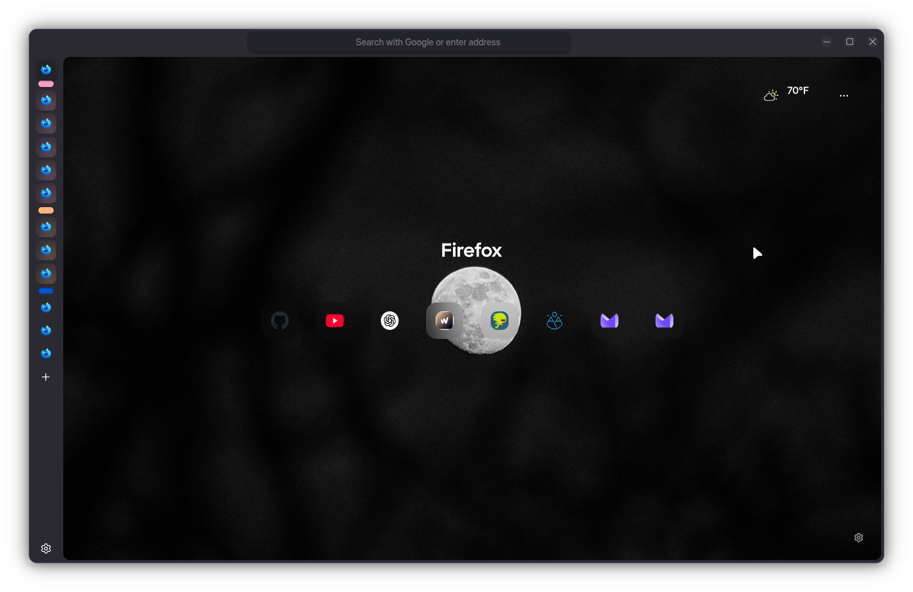
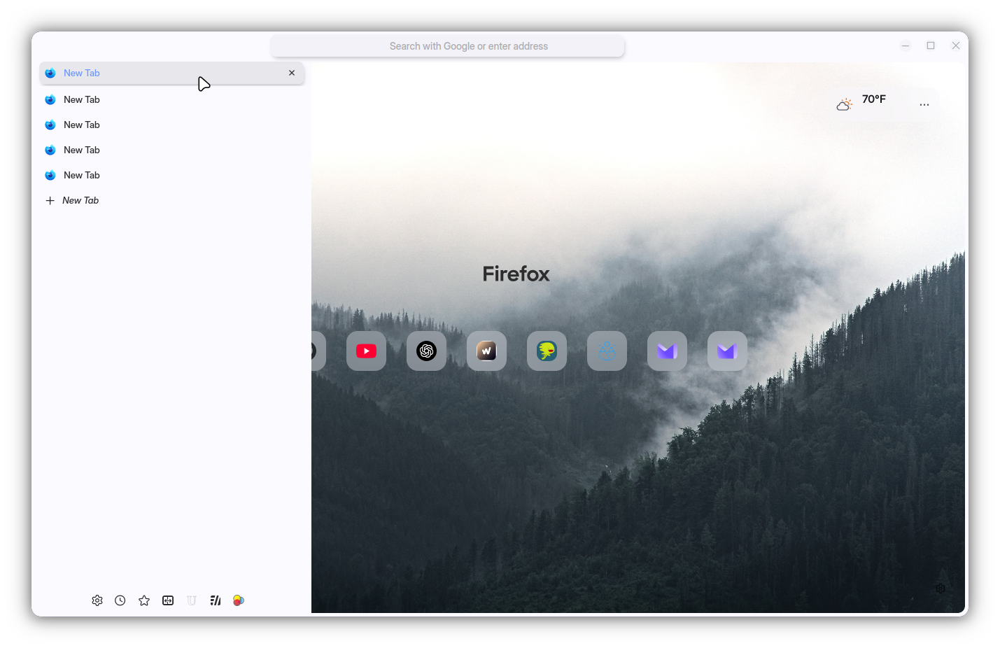

```
FF ULTIMA
Default Edition
By FF ULTIMA
```

This color scheme can be found and used in `userChrome Companions` > `Color Schemes` folder.

Preview:



Color schemes are easy to create: Learn how with the [Color Scheme](/docs/color-schemes/create-a-color-scheme) Wiki.