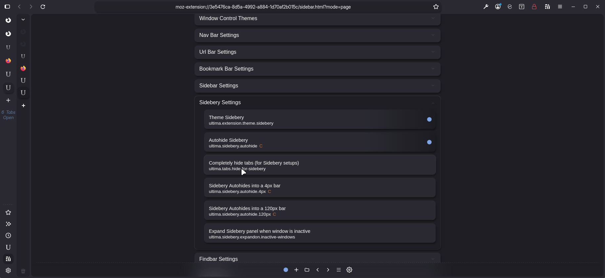
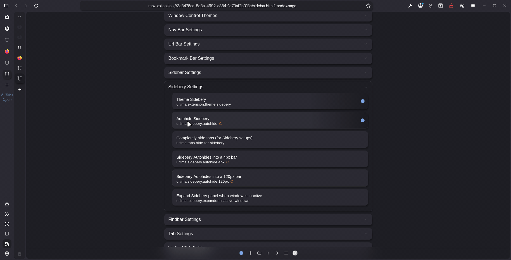

# Sidebery

:::note Sidebery is optional!

Sidebery is not a dependency of FF Ultima and is completely optional, while configuration does exist (below), it is not the primary focus of the theme.

:::

Here's a preview of Vertical Tabs & Sidebery side by side. Can you spot the difference?

 

Well yeah, you can spot the difference. But the point is.. Sidebery is automatically themed to be as consistent as possible to the native vertical tabs. This theming is only based on the colors of the current Color Scheme, so configuring your sidebery in other ways is still possible (since nothing else is modified).

## Sidebery Only Setups

The following settings help create a "Sidebery Only" setup
- `ultima.tabs.hide-for-sidebery` - will automatically hide the tabs bar (vertical or horizontal) whenever Sidebery is open.
<!-- - `ultima.tabs.autohide` - will autohide the tabs bar (vertical or horizontal) within the browsers screen edge. Keeping it still accessible via hover. -->

## Sidebery Autohiding

By default Sidebery Autohide collapses the Sidebar into a ~40px width. Collapsed width can be altered by combining the following settings:

- `ultima.sidebery.autohide` + `ultima.sidebery.autohide.4px`
- `ultima.sidebery.autohide` + `ultima.sidebery.autohide.120px`

## Sidebery Extension Settings

> This is for best compatibility with the theme, other configurations should work just fine but they are unaccounted for.

Basically a top down format works best with FF Ultima's themed Sidebery. Pinned tabs on top, and Navigation horizontal or hidden.

Again, you don't have to use these extension settings, and you can even disable Ultimas Sidebery theming with `ultima.extension.theme.sidebery`

## Personal Configurations

If you ever want to change the Sidebery theme, either change your Color Scheme `ultima.theme` or turn off `ultima.extension.theme.sidebery` to use default Sidebery (unmodified). You may be able to modify FF-Ultima's configuration in Sidebery's Style Editor too (untested).

If you scroll down to `Other` in the Sidebery Style Editor. FF Ultima `uc` variables are recognized and editable. I haven't tested these much but it was surprising to see that Sidebery can detect them.

# That's all

<iframe style={{borderRadius: '6px'}} width="100%" height="490" autoplay="false" src="https://www.youtube.com/embed/xtUBmixQHvo?si=sbwFFhKCRRK4OeaR" title="YouTube video player" frameborder="0" allow="accelerometer; clipboard-write; encrypted-media; gyroscope; picture-in-picture; web-share; fullscreen" referrerpolicy="strict-origin-when-cross-origin" allowfullscreen></iframe>